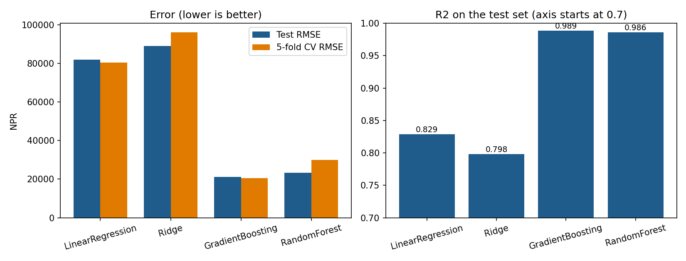
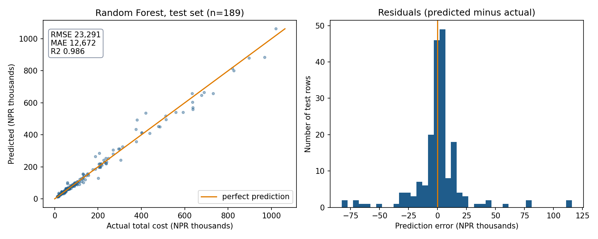
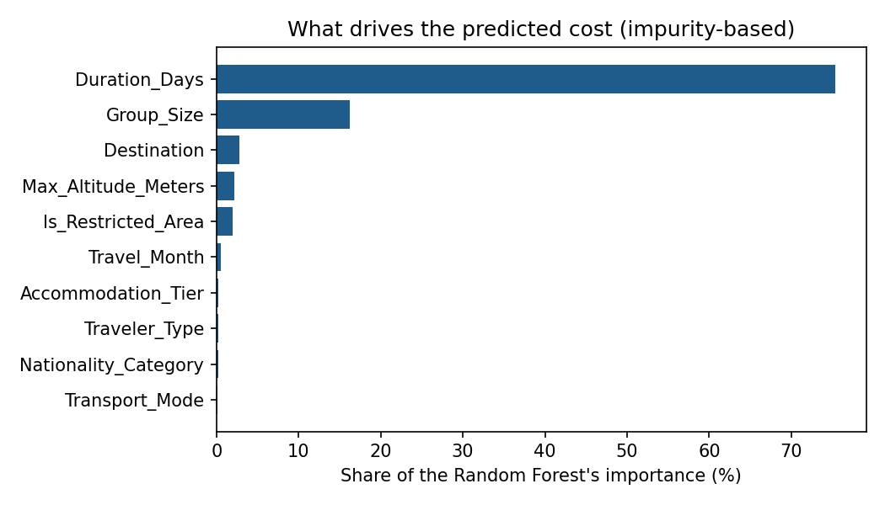
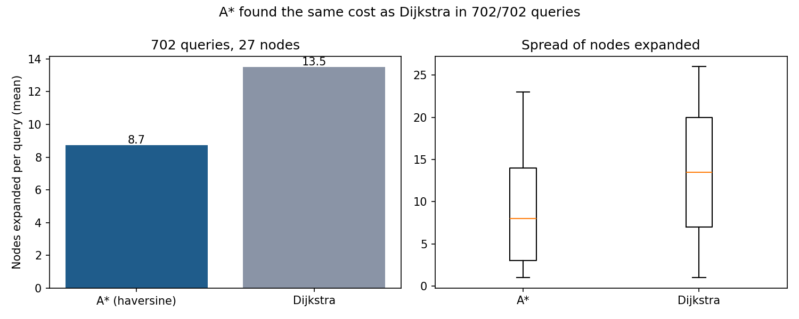
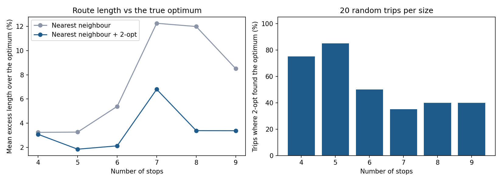
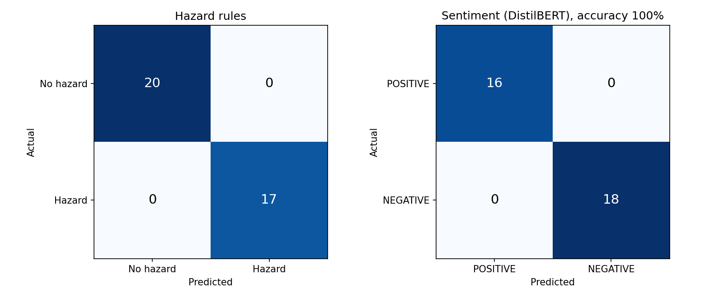

# TrailMind: evaluation evidence

Generated 2026-11-16 by `ml-service/evaluation/make_evidence.py`. Python 3.12.3, numpy 1.26.4, pandas 2.2.2, scikit-learn 1.5.1, matplotlib 3.9.4. Processor: AMD64 Family 25 Model 80 Stepping 0, AuthenticAMD.

## 1. Budget model (Random Forest)

Dataset: 945 rows; trained on 756, tested on 189 (80/20 split, random_state=42). Mean trip cost in the test set: NPR 158,678.

| Model | Test RMSE (NPR) | Test MAE (NPR) | Test R2 | 5-fold CV RMSE (NPR) |
|---|---|---|---|---|
| LinearRegression | 82,058 | 47,816 | 0.829 | 80,501 |
| Ridge | 89,117 | 61,379 | 0.798 | 96,127 |
| GradientBoosting | 21,085 | 12,384 | 0.989 | 20,532 |
| RandomForest | 23,291 | 12,672 | 0.986 | 29,957 |

Final model in the app: **RandomForest**. Source: models/metrics.json (written by train_model.py).

Retrained here on the same split, the Random Forest gives:

| Metric | Value |
|---|---|
| RMSE | 23,291 |
| MAE | 12,672 (8.0% of the mean cost) |
| R2 | 0.986 |
| Predictions within 10% of the actual cost | 65.6% of test rows |
| Predictions within 20% of the actual cost | 86.2% of test rows |
| Reproduces metrics.json | yes |

**Notes to address in the report**

- GradientBoosting has the lowest test RMSE (21,085) and CV RMSE (20,532); the Random Forest has 23,291 and 29,957. Do not claim the Random Forest is the most accurate model; state the reason it was chosen, or be ready to answer the question.
- The Random Forest's cross-validated error (29,957) is higher than its single-split test error (23,291), so the single split looks optimistic; quote both numbers.
- If the dataset was built by the authors or is synthetic, say so. A high R2 on data from one source measures how well the model learned that data, not accuracy on real trips.
- In the app the itemized formula gives the budget; the Random Forest estimate is an independent cross-check.
- Feature importance is impurity-based, which can favour columns with many values (such as Destination).

## 2. Route search: A* vs Dijkstra

Graph: 27 destinations, 218 directed edges (each node linked to its nearest neighbours, weights = straight-line distance x curvature factor). Edge weights are never smaller than the straight-line distance, so the haversine heuristic is admissible.

| Measure | A* | Dijkstra |
|---|---|---|
| Nodes expanded per query (mean) | 8.7 | 13.5 |
| Queries | 702 | 702 |
| Queries where the cost equals the router's A* | 702 | 702 |

A* expanded 35.3% fewer nodes. With only 27 nodes the saving is small in absolute terms; the point is that the result is identical and never worse.

## 3. Multi-stop route order: nearest neighbour, 2-opt and the optimum

For each size, 20 random sets of destinations (fixed seed). The optimum is found by trying every order with the starting stop fixed (the route is a path, and distances depend on direction).

| Stops | NN excess (mean %) | NN + 2-opt excess (mean %) | 2-opt found the optimum | Worst 2-opt excess (%) |
|---|---|---|---|---|
| 4 | 3.2 | 3.1 | 75% | 23.6 |
| 5 | 3.3 | 1.9 | 85% | 16.2 |
| 6 | 5.4 | 2.1 | 50% | 12.4 |
| 7 | 12.3 | 6.8 | 35% | 29.4 |
| 8 | 12.0 | 3.4 | 40% | 14.6 |
| 9 | 8.5 | 3.4 | 40% | 13.7 |

2-opt never makes the nearest-neighbour route longer. Itineraries allow at most 10 stops, so exact search is possible for small trips; the heuristic is what keeps larger trips fast.

## 4. Review safety

Test set: 37 reviews written by the project authors together with the rules, so the hazard result is a regression check, not an independent benchmark. The set is small; treat the percentages as indicative.

**Hazard keyword rules (no model)**

| Metric | Value |
|---|---|
| Precision | 100.0% |
| Recall | 100.0% |
| TP / FP / FN / TN | 17 / 0 / 0 / 20 |

**Sentiment model (DistilBERT SST-2)**

| Metric | Value |
|---|---|
| Accuracy on clearly positive/negative reviews | 100.0% of 34 |
| Mixed reviews skipped | 3 |
| Final safety flags over all reviews | {'WARNING': 17, 'OK': 13, 'CAUTION': 7} |

## 5. Speed

Measured by calling the functions directly on this computer, so no network or server time is included. Itinerary requests also wait for Gemini, which the app limits to 35 seconds before using a template plan.

| Operation | Median (ms) | 95th percentile (ms) | Runs |
|---|---|---|---|
| Budget, itemized formula only | 0.01 | 0.04 | 300 |
| Budget with the Random Forest cross-check | 44.31 | 47.16 | 40 |
| Route search (A*, one query) | 0.03 | 0.06 | 300 |
| Route order for 7 stops (NN + 2-opt) | 0.17 | 0.25 | 30 |
| Hazard scan of one review | 0.03 | 0.04 | 1000 |

## Charts

- 
- 
- 
- 
- 
- 

## How to regenerate

From the ml-service folder: `venv\Scripts\python.exe -m evaluation.make_evidence`

